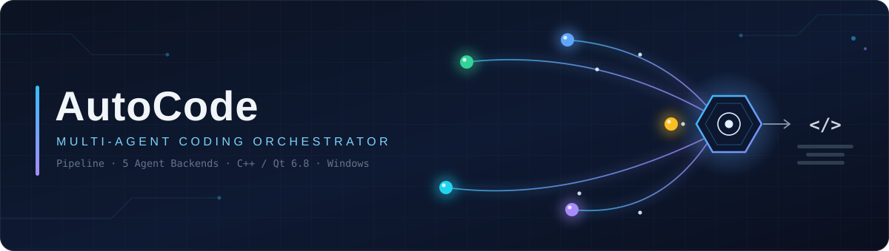
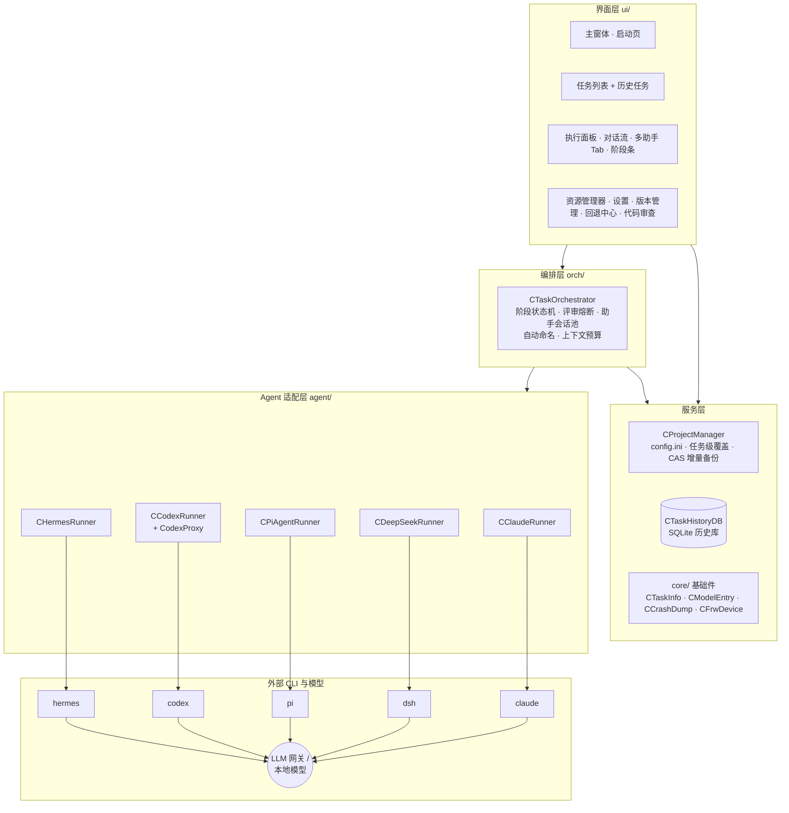
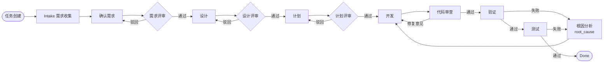
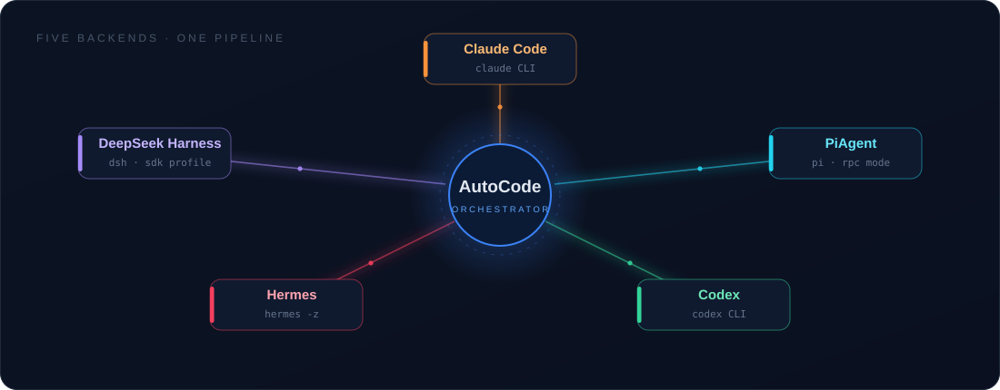
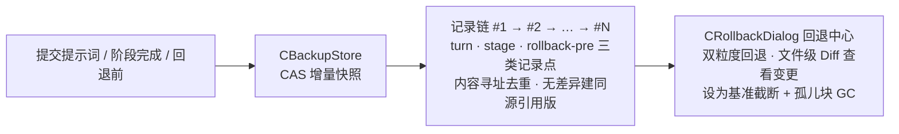

<div align="center">



# AutoCode

**多 Agent 后端驱动的自动化编码任务编排器**

一句需求，一条流水线，五个 AI Agent 后端为你交付代码。


</div>

---

## 📖 这是什么

**AutoCode** 是一个运行于 Windows 的桌面应用（C++ / Qt 6.8 / MSVC），把「AI 编码」组织成一条**可视化流水线**：

> 你用一句需求创建任务，编排器驱动你选定的 Agent CLI，沿 *需求收集 → 确认 → 评审 → 设计 → 计划 → 开发 → 代码审查 → 验证 → 测试* 的阶段状态机自动推进；每个阶段产出结构化文档（`intake.md` / `requirements.md` / `design.md` / `plan.md` …）落盘到工程 `.autodev/tasks/<id>/`，全程对话流可视、可介入、可回退。

它把五个异构 Agent CLI —— **Claude Code、DeepSeek Harness、PiAgent、Codex、Hermes** —— 统一收进同一套 Runner 抽象：统一的事件流解析、工具卡展示、token / 费用计量、上下文监控、会话管理与自愈。切换后端，只是换一个下拉选项。

它为**真实工程的长期开发**而设计：CAS 增量备份与双粒度时光回退、跨会话工程记忆（guide / record / memory）、任务级配置覆盖、多实例在席锁、崩溃转储精确到行——大量在实害中打磨出的工程化细节。

---

## ✨ 核心特性

| | 特性 | 说明 |
|:---:|---|---|
| 🧭 | **可视化任务流水线** | 十二阶段状态机 + 横向图标进度条实时推进；评审驳回自动回炉注入意见，迭代熔断后可**人工介入**（放行 / 再迭代 / 暂停）；验证测试失败走根因分析分支 |
| 🤖 | **五大 Agent 后端** | Claude Code / DeepSeek Harness / PiAgent / Codex / Hermes 统一适配、一键切换；**四后端共享一份模型配置表**，换后端不用重配模型 |
| 🧑‍💻 | **多助手工作台** | 每个助手独立会话、粘性后端、独立统计与撤销栈；运行中提示词暂存排队、多条**合并一次投送**；首轮提示词**自动命名**助手 |
| 🧠 | **工程记忆** | `guide.md` 工程指南 + `record.md` 修改日志 + `memory.md` 任务经验，跨会话持续沉淀工程认知，助手自动同步 |
| 🗂️ | **内置资源管理器** | 多根节点（挂关联项目）、Windows 式拖拽、系统剪贴板联动、原生「打开方式」菜单、编码自探测的文件预览、右键属性 |
| ⏪ | **增量备份 · 时光回退** | CAS 内容寻址增量快照，任务阶段 / 助手轮次**双粒度记录点**，任意回退、文件级 Diff 查看变更、⚓ 设为基准截断释放空间 |
| 🛡️ | **隐藏 UI 测试沙箱** | Ghost 窗口 + 消息级输入模拟 + 离屏截屏 + 过程录制，Agent 自测 GUI 不抢真实键鼠、不闪窗口 |
| 🔍 | **内建代码审查** | ReviewSdk 审查服务、多窗口并行审查、未改码复用上次结果、一键「按建议修复」注入助手 |
| 🩹 | **深度自愈** | 悬空会话重建、坏凭据迁移、上下文超限自动压缩、网关限流长退避、历史库损坏自动重建……十余处运行时自愈点 |
| 🖥️ | **工程化底座** | 崩溃转储精确到函数行、多实例在席锁（内核对象信号）、任务级配置覆盖、配置便携三处落盘、`fileread.dll` 统一磁盘读取 |

---

## 🏛️ 系统架构



**分层职责**

- **界面层**只管呈现与交互，任务/助手两路对话流共用同一套呈现器（卡片流 / 自绘虚拟化双渲染引擎灰度可选）；
- **编排层**是大脑：阶段推进、并行评审、驳回回炉、助手会话池（每助手独立会话与撤销栈）、工作量评估自动调轮次上限；
- **服务层**管持久化：工程配置与任务级覆盖、CAS 增量备份存储、SQLite 历史库（损坏自动体检重建）；
- **适配层**屏蔽五个 CLI 的协议差异（NDJSON / JSONL / RPC / 本地代理），向上抛出统一信号（文本 / 工具卡 / usage / 进度 / 结束）。

---

## 🔄 任务流水线



- **产物落盘**：每阶段输出 Markdown 文档到 `.autodev/tasks/<id>/`，阶段产物页可浏览、另存；
- **评审熔断 → 人工介入**：驳回迭代超限时弹「评审人工介入」，可放行（视为通过）/ 再迭代一轮 / 保持暂停，无人值守批处理也可配置为静默升级；
- **失败分支**：验证 / 测试失败自动转入根因分析，定位后回到开发修复；
- **随时重跑**：阶段条右键任一阶段可「再次执行」。

---

## 🤖 五大 Agent 后端



| 后端 | 形态 | 接入方式 | 特色适配 |
|---|---|---|---|
| **Claude Code** | `claude` CLI（Node） | 自身登录 / 共享表跟随开关 | 悬空会话自动重建、运行中轮中注入、上下文占用精确计量 |
| **DeepSeek Harness** | `bin.js`（Legacy / SDK 双布局） | 组合层模板 + 环境变量注入 | 版本不兼容五步自愈流水线、握手诊断、坏凭据迁移 |
| **PiAgent** | `pi` CLI（RPC 常驻管道） | `~/.pi` 模型表合成写 | `steer` 轮中注入即时生效、限流长退避自动重试、超限自动压缩 |
| **Codex** | `codex` CLI（锁 0.87.0） | 本地代理注入 `max_tokens` / usage 计量 | anthropic-messages 条目自动兑底同名 chat 端点 |
| **Hermes** | Node Harness / venv exe 双形态 | 部署根 `config.yaml` 幂等注入 | oneshot 事件补丁流（工具卡 / 思考流 / 进度）、`TERMINAL_CWD` 工作区锚定 |

**模型配置一份通用**：DSH / Pi / Codex / Hermes 四后端共享同一份「自定义大模型」列表与当前项；上下文占用条右键还能为**单个助手**对话级切换模型，不动全局缺省。

---

## 🖥️ 界面一览


| 左栏 · 任务列表 + 工程资源管理器 | 阶段进度 · 阶段产物 |
|:---:|:---:|
|  |  |


---

## 🧠 工程记忆与多助手

- **三级记忆**：`guide.md`（工程结构与规范速览，助手进工程首次全文投喂、增量提示自取）→ `record.md`（追加式修改日志）→ `memory.md`（任务级经验，供后续任务复用）；
- **多助手并发**：跨助手提交各起各的进程立即运行互不排队；每个助手绑定粘性后端，全局切换不影响在跑会话；
- **自动命名**：助手首轮提示词先「预处理」生成名称与说明（Tab tooltip 展示），再执行指令；任务创建同样按任务内容自动命名；
- **专家模式**（可选）：查询类请求自动跳过深度验证链，改码请求走「计划 → 验证」深度链，输出自动压缩摘要。

---

## ⏪ 增量备份 · 时光回退



- **只备代码相关文件**（源码 / 构建配置 / 文档文本），中间产物与二进制不入库；
- **turn / stage / rollback-pre** 三类记录点覆盖助手每轮对话与任务每个阶段边界；
- 回退中心支持任务侧按阶段、助手侧按轮次的**双粒度回退**，任意文件可打开 Diff 视图查看具体变更；
- 记录过多时「⚓ 设为基准」一键截断更早历史并回收孤儿块，基准点仍可回退。

---

## 🛡️ 工程化底座

<details>
<summary><b>为长跑生产环境打磨的细节（点开）</b></summary>

- **稳定性**：崩溃转储落 `<exe>\dump\`（Release 现产完整 PDB，栈可精确到行）；历史库 SQLite 损坏自动收档重建；十余处运行时自愈（悬空会话 / 坏凭据 / 超限上下文 / 限流退避 / 缺表回写……）
- **便携性**：自有配置只落三处——exe 同级 `config.ini`、Hermes 部署根 `config.yaml`、工程 `.autodev/`；不写注册表、不污染用户主目录
- **多实例**：`Global\AutoCodeSeat_v1_*` 内核对象在席锁 + PID / 创建时刻交叉验证，双开同工程可靠拦截、崩溃残留锁自动接管
- **统一磁盘读取**：全工程文件读取统一走 `fileread.dll`（`CFrwDevice` 适配器），单一读取口径可审计
- **沙箱收养防护**：进程树归属带出生时刻校验，PID 复用不再误收无关窗口
- **多实例配置热同步**：共享 config 变更 2s 防抖热重载，最近列表 / 后端 / 模型表跨实例实时同步

</details>

---

## 📁 目录结构

```text
AutoCode/
├── main.cpp                # 入口：崩溃转储最先装配
├── core/                   # 基础设施：任务元数据 / 模型条目 / 崩溃转储 / 统一磁盘读取 / 编排配置
├── agent/                  # 五个后端 Runner + Codex 本地计量代理
├── orch/                   # CTaskOrchestrator：阶段状态机 / 助手会话池 / 自动命名
├── project/                # CProjectManager + 内嵌 CAS 增量备份存储（CBackupStore）
├── db/                     # CTaskHistoryDB：工程级 SQLite 历史库
├── ui/                     # 主窗体 / 任务列表 / 执行面板 / 设置 / 版本管理 / 回退 / 资源管理器…
├── sandbox/                # 隐藏 UI 测试沙箱（Ghost 窗口 / 录制 / 收养）
├── review/                 # 代码审查服务（ReviewSdk 客户端）
├── tests/                  # 15+ 套 QtTest / CTest 回归
├── scripts/                # 版本号生成 / install_env.bat 源
├── resources/              # 图标资源（SVG 源稿 + 多尺寸 PNG）
├── doc/                    # 设计方案文档
├── help/                   # 用户帮助《使用说明.html》（三方同步）
└── Execute/                # 部署产物：AutoCode.exe · prompts · config.ini · help
```

---

## 🚀 构建与运行

```bash
# 配置 + 构建（Qt 6.8 / MSVC / CMake 预设）
cmake --preset qt6-release
cmake --build --preset qt6-release
```

**部署布局**

```text
Execute\AutoCode.exe           # 主实例（Release，完整 PDB 随部署）
Execute - 副本\AutoCode1.exe   # 第二实例，经 01.更新程序.bat 从 ..\Execute\ 同步
```

- **首次安装**：管理员运行 `install_env.bat`（Git / Node / Agent CLI 工具链一键安装，支持本机源离线装）；
- **运行测试**：

```bash
cd build && ctest -C Release   # 必须带 -C
```

15+ 套回归覆盖执行面板 / 回退存储 / 各后端 Runner / 沙箱 / 版本管理 / 对话流模型等，另含真机端到端目标 `test_orchpi`（编排器 + pi 全链路）。

---

## 📚 更多文档

- **用户帮助**：`help/使用说明.html`（程序内菜单「帮助」打开，含快速上手与 FAQ）；
- **设计方案**：`doc/`（增量备份方案、对话流视图自绘改造方案等）；
- **修改日志**：`readme.txt`（每条带版本号，版本随构建自动推导）。

---

<div align="center">

**AutoCode** · 多 Agent 自动化编码任务编排器 · v4.4.389

*Pipeline · Five Backends · One Cockpit*

</div>
